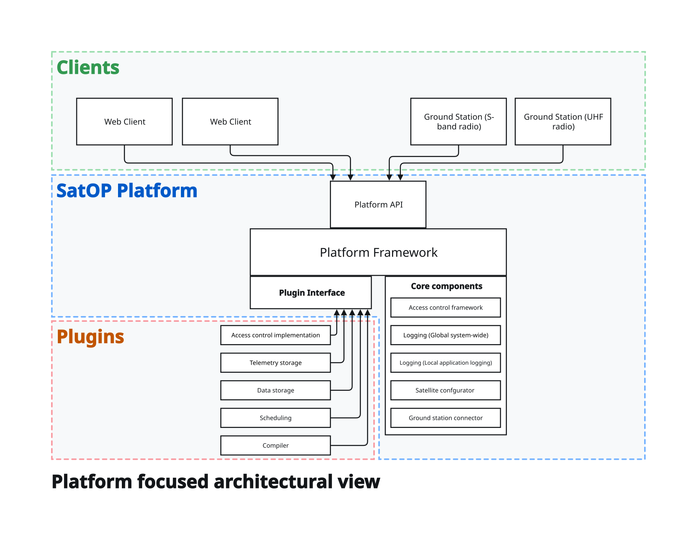
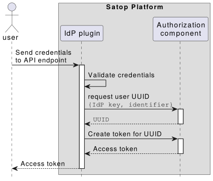

# System architecture

The platform has been designed for satellite missions, focusing on making it general and adaptable to different use cases. Thus, the design consists of 
- **Core framework**: 
The core of the platform, that bootstraps and loads everything else is part of the core framework.
- **Components**: 
Functionality and business logic that are generally applicable for a wide range of different satellite missions and the platform itself are built as components, that can be more tightly integrated. 
- **Plugins**: 
The functionality that should be easily replaceable without risk of breaking the platform is developed as the more loosely coupled plugins. It would generally be that all mission specific logic is developed as plugins.  

The plugins are meant to contain mission-specific and more isolated bits of logic. These should more or less be developed and function independently, but inter-plugin dependencies is possible. 

Plugins can rely on messaging from the platform of various stages of the life-cycle, e.g. startup and shutdown, to perform required actions such as initating or cleaning up database connections. 

## Access control

### Authorization

The platform contains an authorization component, which ensures that a given user or system (collectively referred to as _entities_) has the rights to do what they are attempting with the API.

### Authentication

While authorization is implemented as a core component, the authentication systems could potentially be more dynamic depending on the environment it is deployed in. Thus the authentication (login) logic is implemented as plugins, which allows for interfacing with various user backends or developing one. 

We have developed the following
1. Password authentication allows users to login using an email and a password. 
2. API key allows connecting systems to use an API key to receive an access token.

with the intent of also creating one that authenticates against WAYF.

The authentication flow works as shown here:

The user first authenticates agains the identity provider plugin, which after validation is able to look up the UUID of the user and request an access token for them. 

## Ground station

Ground stations connects to the platform as well. With this connection, they open a WebSocket connection which the platform can use to send commands/requests directly to the ground station. 

A SatOP Client on the ground station is responsible for handling the requests coming from the platform, i.e. scheduling observations, tracking a satellite with the antenna, turn on radios, transmit/receive messages.

## UI / Operations Front-end
